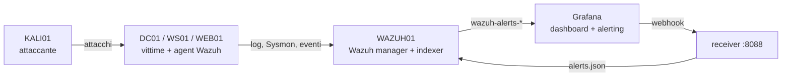

# CyberLab: mini-SOC con Wazuh + Grafana

> [!abstract] In una frase
> Ho un lab con un dominio Active Directory (DC01, `lab.test`) e una Kali che attacca. Sto aggiungendo il lato difensivo: un SIEM (Wazuh) che raccoglie i log, una dashboard (Grafana) che li mostra, e regole di detection scritte da me per gli attacchi che lancio. Il risultato e' un progetto da mostrare a un colloquio per SOC analyst.

## 1. Cosa ho (punto di partenza)

- PC host: Windows 11, 32 GB RAM, VirtualBox.
- **DC01**: Windows Server con Active Directory, dominio `lab.test`.
- **Kali**: gia' installata in dual boot sul PC. Nel lab usero' una VM Kali separata (KALI01), perche' con gli snapshot torno indietro dopo ogni attacco.
- Obsidian per documentare tutto.
- Tempo a disposizione: 2 giorni (da lun 26 ott 2026).

> [!warning] Ancora da verificare (Step 0)
> Stato di DC01: schede di rete in VirtualBox, IP attuale, dominio funzionante, utenti di dominio, snapshot pulito. Non e' stato ancora confermato.

## 2. Cosa sto costruendo

Un ambiente aziendale simulato monitorato da un SIEM. Le macchine, tutte su VirtualBox:

- **WAZUH01** (Ubuntu Server 22.04, 4 CPU, 8 GB RAM, 60 GB): Wazuh all-in-one (manager + indexer + dashboard) e Grafana OSS sullo stesso host. IP `192.168.56.10`.
- **DC01** (Windows Server, ~4 GB): vittima principale, con agent Wazuh e Sysmon. IP `192.168.56.20`.
- **WS01** (Windows Server joinato a `lab.test`, ~4 GB): workstation simulata. Non uso Windows 11 per risparmiare ~6 GB di download e RAM; Sysmon, 4104 e 4688 funzionano uguale. IP `192.168.56.21`.
- **WEB01** (Ubuntu con SSH e web server, ~2 GB): per brute force e File Integrity Monitoring. IP `192.168.56.40`.
- **KALI01** (Kali prebuilt per VirtualBox, ~4 GB): attaccante. IP `192.168.56.30`.

Totale circa 26 GB su 32, host Windows incluso.

### Rete

Ogni VM ha due schede:

1. **NAT**: internet (aggiornamenti, download).
2. **Solo host (Host-only)**: rete del lab `192.168.56.0/24`, IP fissi. Da qui le VM si vedono tra loro e io raggiungo le dashboard dal PC.

> [!note] Perche' non solo NAT
> In VirtualBox la NAT semplice isola ogni VM dalle altre (e le assegna tutte lo stesso IP). Gli agent non raggiungerebbero Wazuh e Kali non raggiungerebbe le vittime. L'alternativa "Rete NAT" funziona ma richiede port forwarding e non isola il lab da internet.

### La pipeline Wazuh <-> Grafana

1. Gli **agent** mandano a Wazuh log Windows (Security, Sysmon, PowerShell) e Linux (auth, FIM).
2. Il **manager** li decodifica, applica le regole e scrive gli alert nell'indexer, indice `wazuh-alerts-*`.
3. **Grafana** interroga l'indexer (datasource `grafana-opensearch-datasource`, utente read-only `grafana_ro`) e mostra le dashboard.
4. Le **regole di alerting di Grafana** osservano gli stessi dati (es. 10+ login falliti in 5 min). Quando scattano inviano un webhook al **receiver** su WAZUH01.
5. Il receiver (Python, servizio systemd, token Bearer) scrive una riga JSON per alert in `/var/log/grafana-alerts/alerts.json`.
6. Wazuh legge quel file con un `<localfile>` di tipo json e le **regole custom 100100-100130** creano l'alert: livello 7 (default), 10 (severity high), 12 (critical), 3 (resolved), 14 (3 critical in 10 minuti, correlazione).

> [!danger] Anti-loop
> Ogni query delle regole Grafana esclude `rule.groups:grafana`. Senza, un alert Grafana diventa un alert Wazuh che riattiva la regola Grafana, all'infinito.

## 3. Cosa sto facendo (stato attuale)

- [x] Pianificazione architettura e scelte (host Windows + VirtualBox, Wazuh e Grafana insieme, Kali VM, WS01 come member server).
- [x] Pacchetto `soc-homelab` scritto: script di installazione, receiver, regole custom, provisioning Grafana, 2 dashboard, 3 regole di alerting, test della pipeline. Collaudato solo in locale (receiver, validita' XML/YAML/JSON, sintassi script).
- [ ] Non ancora collaudato su Wazuh e Grafana veri: regole, pannelli delle dashboard, apertura indexer. Potrebbero servire correzioni.
- [ ] **Step 0**: verifica DC01 (rete, dominio, snapshot `DC01-pulito`).

## 4. Roadmap in ordine (con controllo finale di ogni blocco)

1. **DC01 e rete** (15 min). Snapshot `DC01-pulito`; scheda 2 Solo host; IP `192.168.56.20/24`, nessun gateway, DNS `127.0.0.1`. *Controllo*: `Get-ADDomain` mostra `lab.test`, `ipconfig` mostra il nuovo IP.
2. **Crea WAZUH01** (30 min). ISO Ubuntu Server 22.04, hostname `wazuh01`, OpenSSH. *Controllo*: `ip a` mostra due schede.
3. **IP fisso WAZUH01** (5 min). netplan, `192.168.56.10` sulla scheda host-only. *Controllo*: ping verso DC01.
4. **Wazuh + Grafana** (40 min). Script del pacchetto in ordine, poi `99-test-pipeline.sh`. *Controllo*: dashboard `https://192.168.56.10`, alert di prova presente.
5. **Agent su DC01** (30 min). Dashboard Wazuh, Deploy new agent. *Controllo*: DC01 "Active".
6. **Sysmon e audit su DC01** (30 min). Sysmon con config SwiftOnSecurity, PowerShell Script Block Logging, audit policy. *Controllo*: eventi Sysmon visibili in Wazuh.
7. **Grafana e alerting** (30 min). Save & test del datasource, `02-enable-alert-rules.sh`. *Controllo*: dashboard con dati di DC01.
8. **WS01 e WEB01** (1,5 ore). *Controllo*: 3 agent attivi.
9. **KALI01** (30 min). Import dell'immagine prebuilt, scheda Solo host, `192.168.56.30`, cambio password di default. *Controllo*: ping verso le vittime.
10. **Scenari attacco -> detection** (circa 1 giorno).
11. **Consegna** (3 ore): repo GitHub, report, eventuale video.

## 5. Come lo uso

**Avvio del lab**: accendo prima WAZUH01, poi DC01, WS01, WEB01, infine KALI01 solo quando serve.

- Dashboard Wazuh: `https://192.168.56.10` (utente `admin`, password nel file di installazione).
- Grafana: `http://192.168.56.10:3000`. Cartella **Wazuh SOC**: *SOC Overview* (alert nel tempo, top regole, top agenti, MITRE, ultimi alert) e *Identity & Endpoint* (login falliti, IP sorgente, 4625, gruppi privilegiati, FIM).
- Verifica pipeline: `sudo wazuh01/99-test-pipeline.sh` su WAZUH01.
- Log utili: `/var/ossec/logs/ossec.log`, `/var/ossec/logs/alerts/alerts.json`, `journalctl -u grafana-receiver`, `journalctl -u grafana-server`.
- Test regole: `sudo /var/ossec/bin/wazuh-analysisd -t` (sintassi) e `wazuh-logtest` (cosa matcha una riga).

**Ciclo di lavoro per ogni scenario**
1. Snapshot di tutte le VM coinvolte.
2. Attacco da Kali.
3. Cerco l'evidenza nei log e in Wazuh (id regola, livello, campi decodificati).
4. Se manca la detection, scrivo o correggo la regola custom (ID 100200+, tag MITRE).
5. Valuto i falsi positivi e faccio tuning.
6. Scrivo l'incident report.
7. Ripristino lo snapshot.

> [!warning] Sicurezza
> Gli attacchi vanno solo verso le VM del lab, sulla rete Solo host. Mai verso la rete di casa o sistemi di terzi.

## 6. Scenari di attacco previsti

- **Brute force SSH su WEB01** (T1110) + active response che blocca l'IP.
- **Kerberoasting su DC01** (T1558.003): evento 4769 con cifratura RC4 (`0x17`).
- **Credential dumping** (T1003.001): accesso a lsass, Sysmon evento 10.
- **PowerShell encoded/offuscato** (T1059.001): 4104 e command line con `-enc`.
- **Persistenza** (T1053, T1547): scheduled task o chiave Run, Sysmon 1 e 13.
- **Nuovo utente in Domain Admins** (T1098): eventi 4720, 4728/4732. Bonus: webshell su WEB01 rilevata dal FIM.

Per ognuno devo saper dire: perche' genera falsi positivi e come li ho ridotti.

## 7. Obiettivi del progetto

1. **Tecnico**: un SIEM funzionante con agent su Windows e Linux, telemetria utile (Sysmon, audit), dashboard operative, alerting e una pipeline Wazuh <-> Grafana.
2. **Detection engineering**: almeno 5-6 regole custom mappate su MITRE ATT&CK, collaudate con attacchi veri.
3. **Analisi**: un incident report per scenario (timeline, IOC, tecnica MITRE, evidenze, raccomandazioni). E' la prova che so analizzare, non solo installare.
4. **Portfolio**: repo GitHub con README, diagramma architettura, regole XML, dashboard esportate (JSON), config Sysmon e cartella `incident-reports/`. Se avanza tempo, un video di 3-4 minuti con un attacco che compare in dashboard.
5. **Colloquio**: saper raccontare le scelte (rete, anti-loop, perche' Sysmon, perche' l'indexer read-only) e i problemi incontrati con la soluzione.

**Se manca il tempo, taglio in quest'ordine**: video, dashboard Endpoint, scenario 6. Non taglio mai i report.

## 8. Rischi e punti aperti

- Pannelli delle dashboard e regole di alerting scritti ma non provati in Grafana reale: possibili campi o query da correggere (nome dei campi Windows, ad esempio).
- Nell'all-in-one l'indexer ascolta solo su `127.0.0.1`. Su singolo host non serve aprirlo; il pacchetto prevede la modifica (`network.host`) solo se Grafana e' su un altro host. Rollback: `cp /etc/wazuh-indexer/opensearch.yml.bak /etc/wazuh-indexer/opensearch.yml && systemctl restart wazuh-indexer`.
- Versione OpenSearch nel datasource impostata a `2.13.0`: se Grafana propone un'altra versione, usa quella.
- RAM: 26 GB su 32 con tutte le VM accese. Se rallenta, spengo WS01 o KALI01 quando non servono.
- Disco: controllare lo spazio libero su C: prima di importare Kali (~4 GB) e creare le VM.

## 9. Cosa ho imparato (da compilare man mano)

-
-
-

## 10. Log di lavoro

- 2026-10-26: definito il progetto e l'architettura; scritto il pacchetto `soc-homelab`.
- 2026-10-27: scelte ISO (Ubuntu 22.04, Kali prebuilt, WS01 come member server). Prossimo: Step 0 su DC01.
